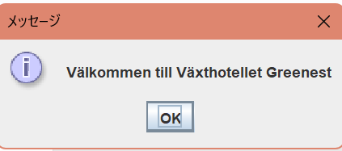
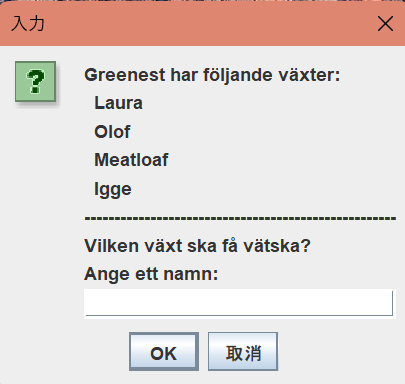
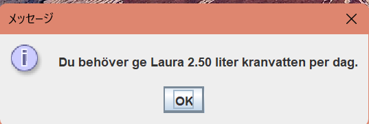
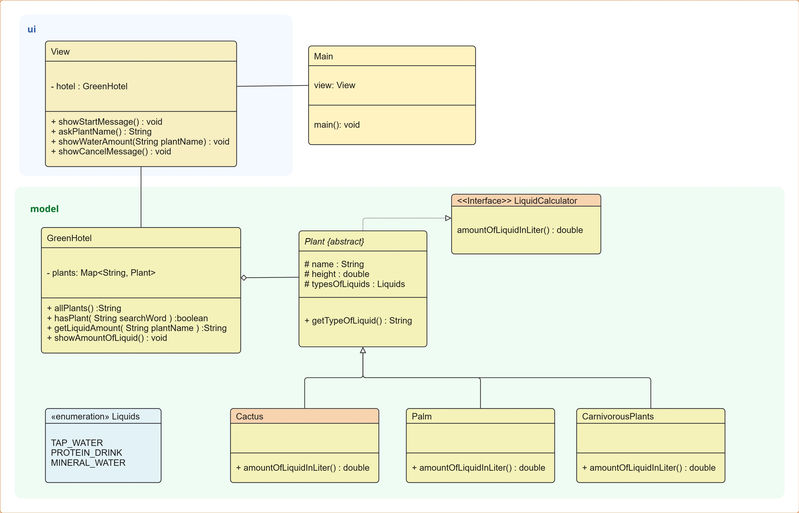

[English README](README.md)

# Växthotellet Greenest 🌱

Ett Java-program som hjälper växthotellet Greenest att beräkna hur mycket vätska olika växter behöver per dag.  
Projektet är en skoluppgift i objektorienterad programmering där fokus ligger på arv, interface, polymorfism, enum och inkapsling.

## Funktioner

- Visa ett välkomstmeddelande
- Visa vilka växter som finns på hotellet
- Låta användaren ange en växt via dialogruta
- Beräkna rätt mängd vätska
- Visa rätt vätsketyp
- Hantera felaktig, tom eller avbruten inmatning

## Demo

### 1. Välkomstmeddelande

### 2. Välj en växt

### 3. Resultat

## UML-diagram

Nedan visas projektets klassdiagram.

## Design och objektorientering

Projektet är utvecklat med objektorienterade principer i fokus.

### Använda OOP-koncept

- **Arv** – `Palm`, `Cactus` och `CarnivorousPlants` ärver från `Plant`
- **Polymorfism** – varje växttyp implementerar sin egen beräkning av vätskebehov
- **Interface** – `LiquidCalculator` definierar beräkningsmetoden
- **Enum** – `Liquids` används för att representera vätsketyper
- **Inkapsling** – `GreenHotel` skyddar sin plantsamling och exponerar bara nödvändiga metoder

## SOLID och ansvarsfördelning

Projektet är utvecklat med hänsyn till **SOLID-principerna**, framför allt **Single Responsibility Principle (SRP)**.  
Det betyder att varje klass har ett tydligt och avgränsat ansvar.

### Klassernas ansvar

| Klass / Typ | Ansvar |
|---|---|
| `Main` | Startar programmet |
| `View` | Hanterar användargränssnittet och dialogrutorna |
| `GreenHotel` | Lagrar hotellets växter och hämtar information om dem |
| `Plant` | Representerar gemensamma egenskaper för alla växter |
| `Palm` | Beräknar vätskebehov för palmer |
| `Cactus` | Beräknar vätskebehov för kaktusar |
| `CarnivorousPlants` | Beräknar vätskebehov för köttätande växter |
| `LiquidCalculator` | Definierar kontraktet för vätskebehovsberäkning |
| `Liquids` | Representerar vilka vätskor som kan användas |

### Exempel på Single Responsibility Principle

- `View` ansvarar bara för **presentation och inmatning**
- `GreenHotel` ansvarar bara för **hantering av växtdata**
- Varje växtklass ansvarar bara för **sin egen beräkningslogik**
- `Main` ansvarar bara för **att starta programmet**

Det gör koden tydligare, lättare att underhålla och enklare att vidareutveckla.

## Teknik

- **Java 25**
- **Swing / JOptionPane**
- **IntelliJ IDEA**

## Kör programmet

1. Öppna projektet i **IntelliJ IDEA**
2. Ställ in **JDK 25** som Project SDK
3. Kör programmets startklass `Main`

## Projektstatus

Projektet uppfyller uppgiftens grundläggande krav och visar tydligt användning av objektorienterade koncept som arv, interface, polymorfism, enum och inkapsling.
